# Steelworks Media Optimiser

Makes heavy Figma Slides decks fast again, without Claude and without anyone touching a script.

It reads every slide, then, step by step and with your approval:

| Step | What happens |
|---|---|
| **Review** | Lists every image, GIF and video with file size, pixel size and on-slide size (crop included), plus hidden, switched-off, off-slide and fully covered media, and uneven thumbnail grids. |
| **Clean up** | Removes media nobody can see, after you tick through a review list. |
| **Images** | Resizes to 1.5× the on-slide size (max 2560 px, never upscaled), saves JPEG q86, or WebP q88 when the image really has transparency, and only keeps a result that is at least 30% smaller. Swaps it in place, keeping the scale mode and crop. |
| **Videos & GIFs** | Finds each original video in the Steelworks Dropbox (team folders, shared folders, files that aren't synced), proves it's the exact file by SHA-1, compresses it (1080p, H.264 CRF 22, AAC 128k, faststart) and puts it back. GIFs become silent, looping, autoplaying MP4s. |
| **Spacing** | Sets thumbnail grids to 16 px gaps, keeping the outer edges. Collages and overlapping layouts are skipped. |
| **Alignment** | Puts repeating headers and footers (logos, titles, page numbers) in the same place on every slide, and snaps text and layers that sit a few pixels off a margin or column. |
| **Report** | Before and after sizes, an HTML report, a **replace list** (CSV) for anything that needs a person, and an **undo log**. |

On the sample deck: **93.9 MB → 5.0 MB** (images 42.2 → 1.4 MB, videos 51.7 → 3.6 MB). The old manual process took the real decks from 572 MB → 24 MB of images and 1.1 GB → 160 MB of video.

## Download

Get the latest version from **[Releases](../../releases/latest)**:

| Your computer | File |
|---|---|
| Windows 10 / 11 | `Steelworks-Media-Optimiser-…-Windows-Setup.exe` |
| Mac with Apple silicon (M1–M4) | `Steelworks-Media-Optimiser-…-macOS-arm64.dmg` |
| Intel Mac | `Steelworks-Media-Optimiser-…-macOS-x86_64.dmg` |
| Figma plugin (everyone) | `Steelworks-Media-Optimiser-Figma-Plugin-….zip` |

Then follow the **[user guide](docs/USER_GUIDE.md)**: it walks through every screen.

## What it looks like

| | |
|---|---|
| **Connect:** Figma, Dropbox and the plugin, paired with a code<br>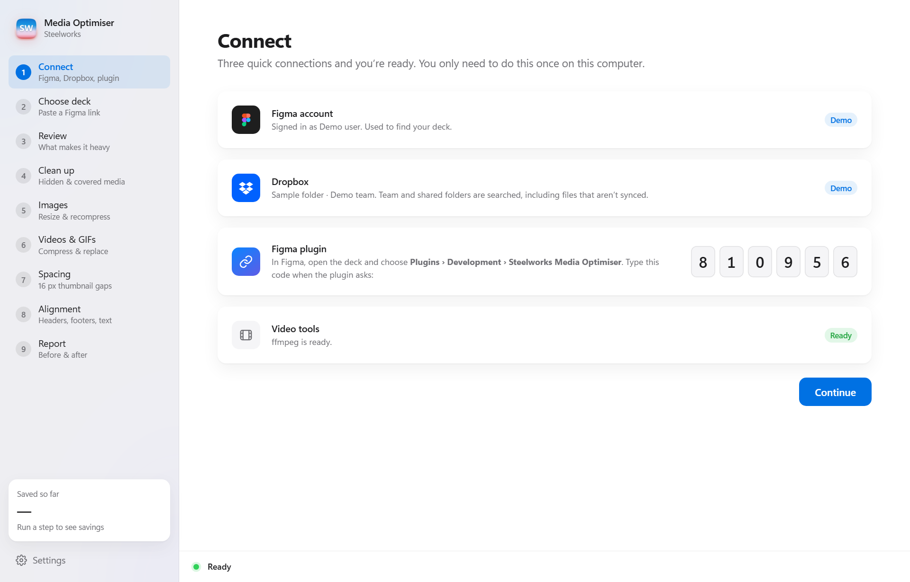 | **Review:** what makes the deck heavy, slide by slide<br>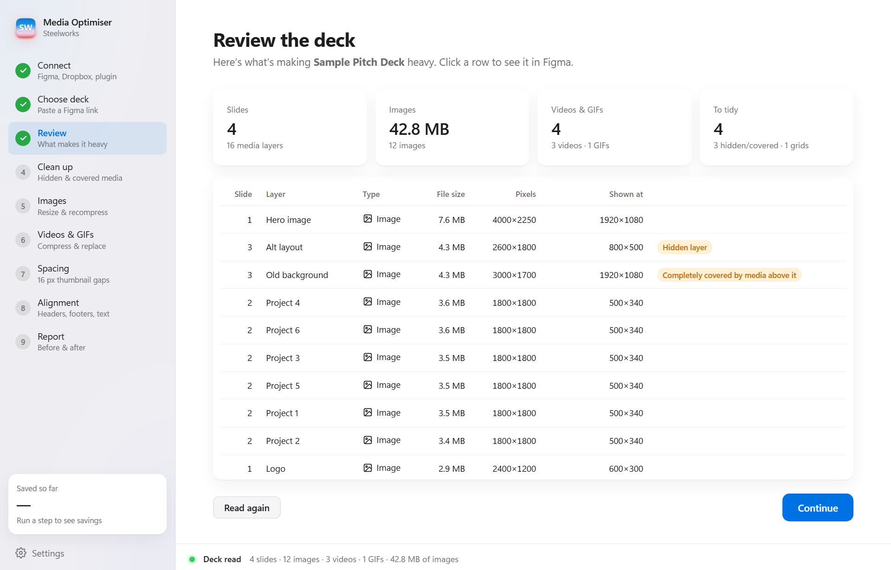 |
| **Clean up:** hidden, switched-off and covered media<br>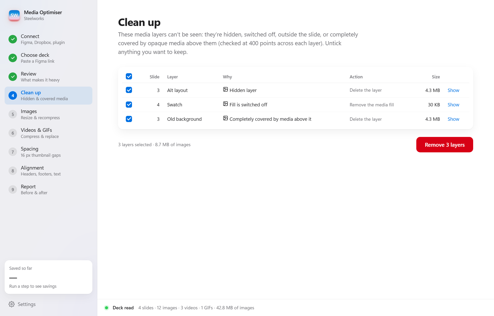 | **Images:** resized to 1.5× display size<br>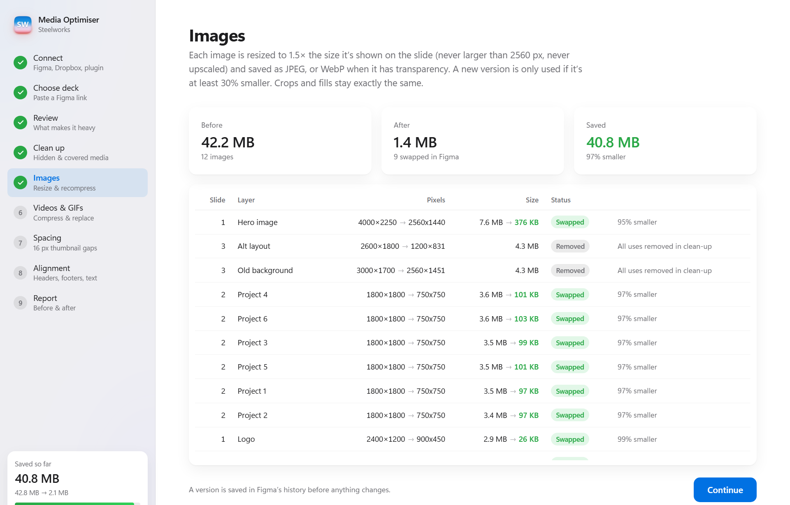 |
| **Videos & GIFs:** found in Dropbox, proven by SHA-1, compressed<br>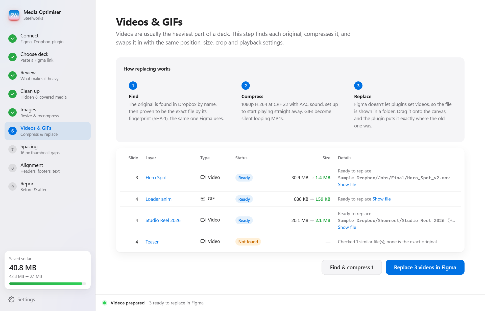 | **Spacing:** 16 px thumbnail grids<br>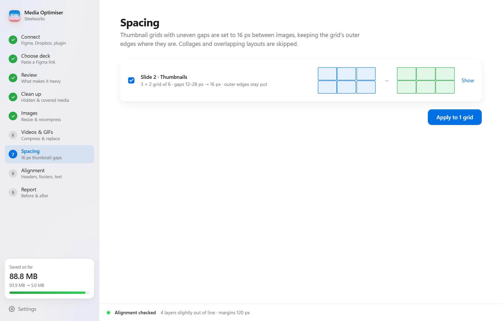 |
| **Alignment:** headers, footers and text on the layout<br>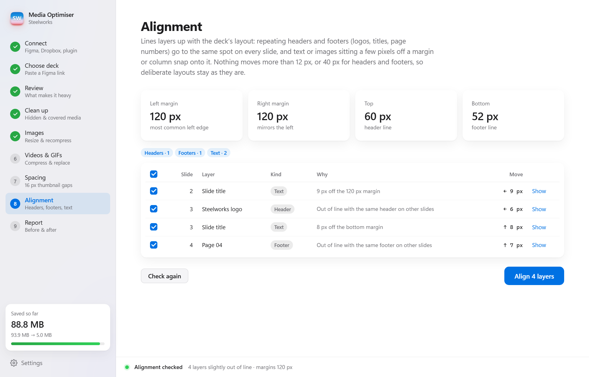 | **Report:** before and after, replace list, undo<br>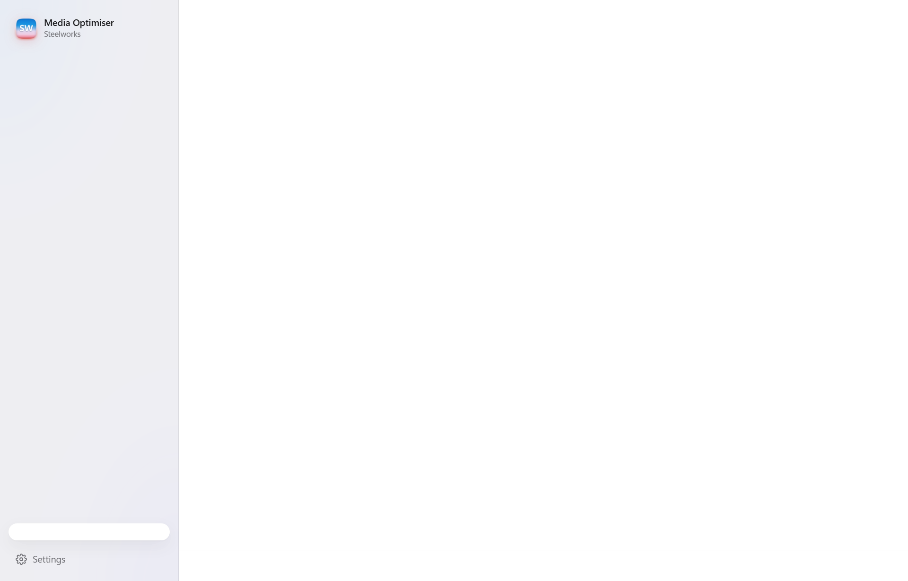 |
| **Settings:** every key has an ⓘ explaining how to get it<br>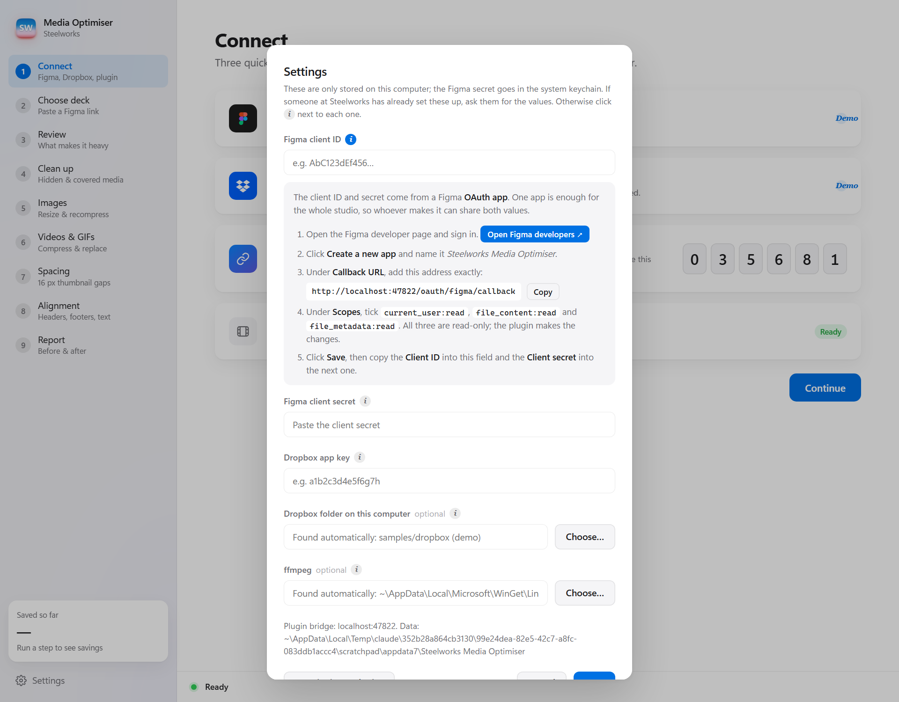 | **Dark mode** follows the system<br>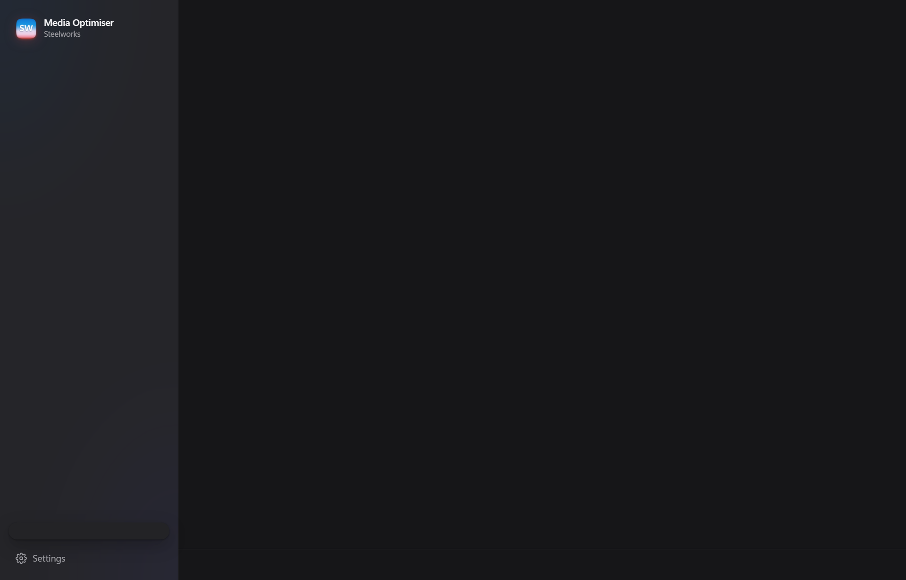 |

**The Figma plugin panel:**

| Pair once | Connected | Guided video drag-in |
|---|---|---|
| 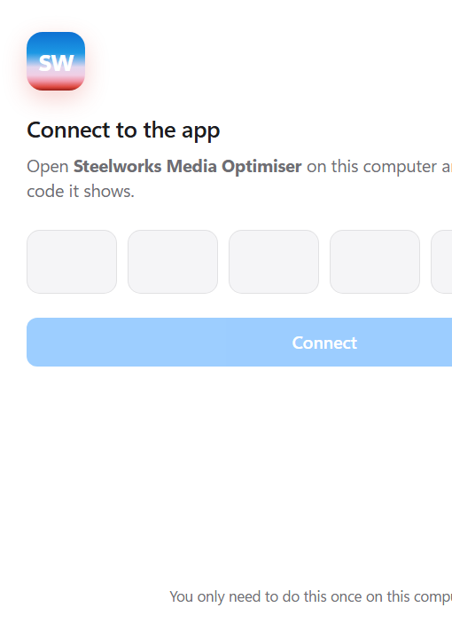 | 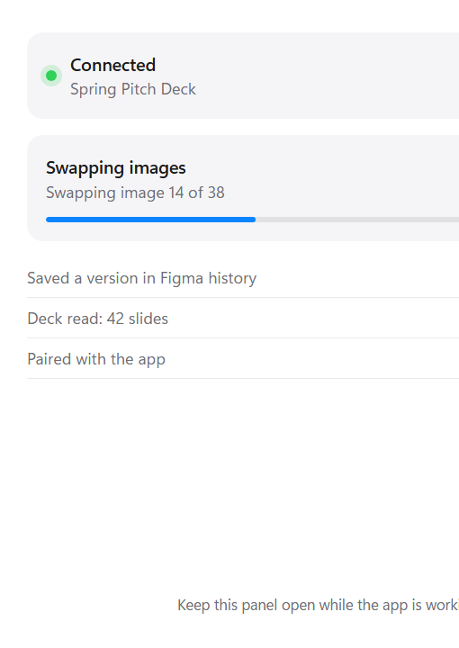 | 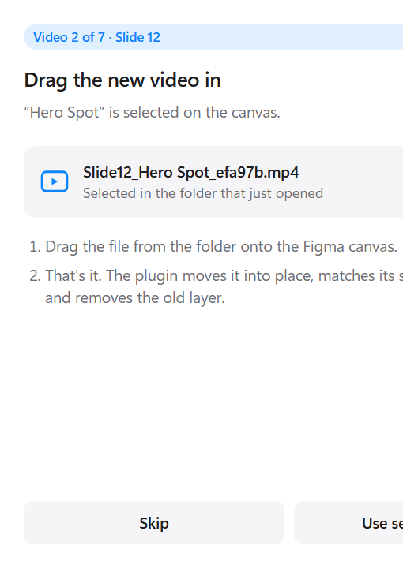 |

---

## How it fits together

```
┌──────────────────────────────┐   ws://localhost:47821/plugin   ┌──────────────────────────────┐
│  Figma plugin (in the deck)  │ ◀────────────────────────────▶ │  Desktop app (Windows/macOS)  │
│  • inventory & coverage       │   paired with a 6-digit code    │  • step-by-step UI            │
│  • swap image fills           │   HTTP /blob  (original bytes)  │  • Figma + Dropbox OAuth/PKCE │
│  • remove layers / fills      │   HTTP /out   (optimised files) │  • Pillow image compression   │
│  • spacing & alignment moves  │                                 │  • ffmpeg video/GIF           │
│  • video placement            │                                 │  • job queue, parallel workers│
└──────────────────────────────┘                                 │  • report, replace list, undo │
                                                                  └──────────────┬───────────────┘
                                                                     Dropbox API │ Figma REST (read-only)
```

* **Why a plugin:** the Figma REST API is read-only. Only a plugin can change a deck.
* **Why a desktop app:** plugins can't run ffmpeg, keep OAuth tokens safely, or reach Dropbox at full speed.
* **Why Python + pywebview, not Electron or Tauri:** the window is the system's own web view (WebView2 on Windows, WKWebView on macOS, with native vibrancy). The installer is small, and Pillow is the exact encoder the manual run used, so results match. No Node or Rust toolchain is needed to build it.

### Replacing videos (the plugin API can't set VIDEO fills)

The app tries two paths and picks the right one per Figma build:

1. **Automatic:** if the running Figma exposes `figma.createVideoAsync`, the plugin uploads the compressed MP4 and swaps the paint directly, keeping crop, scale mode and playback.
2. **Guided drag-in (the path verified in the manual run):** the app selects the compressed file in Explorer/Finder, and the plugin selects and zooms to the original layer, showing *"Drag ‘Slide12_Hero.mp4’ onto the canvas"*. As soon as Figma creates the new video layer (detected through `documentchange`), the plugin:
   * moves it into the original's parent **at the same stacking position**,
   * copies the relative transform (x, y, rotation), size, name, opacity, blend mode, constraints, effects and corner radius,
   * copies the original paint's scale mode and crop, and playback settings where Figma exposes them,
   * removes the original. If the original was a frame background with children, the video goes inside the frame at the back instead.

   If detection ever misses, select the new layer and press **Use selected layer**. **Skip** leaves it on the replace list.

GIFs follow the same path, set to autoplay, loop, muted and no controls. Where this Figma build doesn't expose playback settings to plugins, the layer is listed in the replace list as *"Check playback"*.

### Matching videos to their source

`search_v2` runs from the **team root namespace**, so team folders are included. Unmounted shared folders are searched through their own namespace. The results are scored with fuzzy name matching (copy suffixes like `(1)`, `copy` and ` 2` are ignored, along with case, punctuation and camelCase). Candidates are then **hashed** in a set order: locally synced copies first (free), then the smallest. Downloads are hashed as they stream. A file only counts as the source when **SHA-1(file) == Figma videoHash**, so a same-named older render is never used. Hashes are cached between runs.

---

## Install (everyone in the studio)

**Windows 10/11:** run `Steelworks-Media-Optimiser-1.0.0-Windows-Setup.exe`. No admin rights needed, and ffmpeg is included.

**macOS 11+:** open `Steelworks-Media-Optimiser-1.0.0-macOS-arm64.dmg` (Apple silicon) or `-x86_64.dmg` (Intel) and drag the app into Applications. The release builds include ffmpeg; if the Connect page ever says *Missing*, run `brew install ffmpeg`. The app isn't signed by Apple yet: the first time, right-click it, choose **Open**, then **Open** again.

**The Figma plugin (once per person):**
1. In the Figma desktop app: **Plugins › Development › Import plugin from manifest…**
2. Pick `manifest.json` from the plugin folder. On Windows there's a Start-menu shortcut called *Steelworks Media Optimiser – Figma plugin folder*. You can also use `Steelworks-Media-Optimiser-Figma-Plugin-1.0.0.zip` (unzip first), or `plugin/manifest.json` in this repo.
3. Open a deck and run **Plugins › Development › Steelworks Media Optimiser**. Type the six-digit code the app shows. You only pair once per computer.

Later, an admin can publish the plugin privately to the Steelworks organisation (**Plugins › Manage plugins › Publish**, *private to organisation*) so nobody has to import it. If you do, Figma gives the plugin a numeric `id`; put it in `plugin/manifest.json`.

---

## One-time setup for IT: OAuth apps and keys

The same steps are built into the app: click the **ⓘ** next to each field in **Settings**.

Nothing secret is in the source code. The app reads keys from, in this order:

1. Environment variables: `SMO_FIGMA_CLIENT_ID`, `SMO_FIGMA_CLIENT_SECRET`, `SMO_DROPBOX_APP_KEY` (optional: `SMO_PORT`, `SMO_FFMPEG`, `SMO_LOCAL_DROPBOX_ROOT`)
2. The **Settings** window in the app, saved to `%APPDATA%\Steelworks Media Optimiser\config.json` or `~/Library/Application Support/Steelworks Media Optimiser/config.json`. The Figma secret goes into Windows DPAPI or the macOS Keychain.
3. A studio-wide **`steelworks.config.json`** next to the app (or in the data folder above). Put only the *non-secret* IDs here. If the file is in the repo root when you build, it's bundled into the installer:
   ```json
   { "figma_client_id": "…", "dropbox_app_key": "…" }
   ```

Tokens are stored per user in DPAPI or the Keychain, never in plain text on Windows or macOS.

### Figma OAuth app
1. Go to <https://www.figma.com/developers/apps> and choose **Create a new app**. Name: *Steelworks Media Optimiser*.
2. **Callback / redirect URL:** `http://localhost:47821/oauth/figma/callback`
3. **Scopes:** `current_user:read`, `file_content:read`, `file_metadata:read` (read-only; all edits go through the plugin).
4. Copy the **Client ID** and **Client secret** into Settings (or the env vars).
5. If colleagues outside the app's owner team can't sign in, publish the OAuth app to the organisation in its settings.

Figma's token exchange needs the client secret, and a desktop app can't truly hide one. The app's scopes are read-only to limit the risk. Rotate the secret in the Figma developer page if it leaks.

Figma sign-in is optional. It's only used to confirm the deck from its link and show its name and thumbnail. Everything else works through the plugin.

### Dropbox app (team account)
1. Go to <https://www.dropbox.com/developers/apps> and choose **Create app**, then **Scoped access**, then **Full Dropbox**. Name: *Steelworks Media Optimiser*.
2. **Permissions** tab: tick `account_info.read`, `files.metadata.read`, `files.content.read`, `sharing.read`, then **Submit**.
3. **Settings** tab:
   * **Redirect URIs:** add `http://localhost:47821/oauth/dropbox/callback`
   * **Allow public clients (Implicit Grant & PKCE):** *Allow*. The app uses PKCE, so no Dropbox secret is ever needed.
4. Copy the **App key** into Settings, the env var or `steelworks.config.json`.
5. A new app is in *development* status and can be linked by a limited number of users. That's usually enough for a studio. Choose **Apply for production** if you need more.

Each person signs in with their own Steelworks Dropbox account. The app searches from the team root, so it sees every team folder and shared folder that person can see.

### Port
The plugin talks to `localhost:47821`. If that port is taken, set `SMO_PORT` **and** change both `networkAccess` entries in `plugin/manifest.json`.

---

## Run from source

Needs Python 3.11+ and ffmpeg (`winget install Gyan.FFmpeg` or `brew install ffmpeg`).

```powershell
python -m pip install -r requirements.txt
```
```powershell
python plugin/build.py
```
```powershell
python app/run.py
```

Options: `--browser` (open in the default browser instead of a window), `--headless`, `--port N`, `--demo`.

### Try it without any keys (demo)

```powershell
python scripts/make_samples.py
```
```powershell
python app/run.py --demo --browser
```

Then open `http://localhost:47821/harness/harness/harness.html` in a second tab. This runs the **real plugin code** (`plugin/dist/code.js` and `ui.html`) against a mock of the Figma API (`plugin/harness/mock-figma.js`) loaded with a sample deck. It pairs itself, and it simulates the drag-in for the guided video step. The mock mirrors Figma's limits: fills are read-only snapshots, plugins can't create VIDEO paints, and images are keyed by SHA-1. *Sample Dropbox* is `samples/dropbox`, which contains the real originals plus decoys with the same names but different bytes.

## Tests

```powershell
python -m unittest discover -s tests
```
```powershell
python scripts/run_js_tests.py
```

* `tests/test_matching_hashing.py`: name normalisation, fuzzy scoring and ranking, SHA-1 helpers, `find_source` (the hash decides, not the name; mismatched downloads are deleted; failing sources don't stop others; cache).
* `tests/test_compression.py`: the 1.5× / 2560 / no-upscale maths, JPEG vs WebP by real alpha, the 30% rule, ICC kept, EXIF-rotated and animated inputs, and real ffmpeg runs (1080p, portrait, no upscale, AAC, faststart `moov` before `mdat`, GIF to silent even-sized MP4).
* `tests/test_bridge_dropbox.py`: pairing codes are single-use, stale tokens, RPC with progress, blob hash check, path traversal, DNS-rebinding guard, Private Network Access preflight, the Dropbox team-root header, unmounted shared folders, stream-hashing, preferring a synced local copy, DPAPI at rest.
* `tests/js/core.test.html`: plugin logic. Required size for FILL, FIT, CROP and TILE; format and opacity sniffing; coverage (stacked covers, rotation, clipping, rounded corners, slivers, off-slide); grid detection and the 16 px plan; alignment guides, header and footer consensus, tolerances.

## Build installers

| Platform | Command | Output (in `dist/`) |
|---|---|---|
| Windows | `powershell -ExecutionPolicy Bypass -File scripts\build_windows.ps1` | `Steelworks-Media-Optimiser-1.0.0-Windows-Setup.exe` |
| macOS | `./scripts/build_macos.sh` (run on a Mac) | `Steelworks-Media-Optimiser-1.0.0-macOS-<arch>.dmg` |
| Both | `.github/workflows/build.yml`: push a tag like `v1.0.1`, or Actions › *Build installers* › Run | Windows, macOS arm64 and macOS x86_64, published as a Release when tagged |

Both also write `Steelworks-Media-Optimiser-Figma-Plugin-1.0.0.zip`. The build runs all tests first (`--skip-tests` skips them). On Windows it bundles ffmpeg from your PATH (`--no-ffmpeg` to skip). On macOS it bundles ffmpeg only if you put static `ffmpeg`/`ffprobe` builds in `vendor/ffmpeg/`, because Homebrew's build isn't self-contained. To sign and notarise on macOS, set `SMO_SIGN_IDENTITY="Developer ID Application: …"` and `SMO_NOTARY_PROFILE=<notarytool keychain profile>`. Bundled ffmpeg is GPL-licensed, which is fine for internal use. Check before distributing outside the studio.

## Security

* The bridge listens on loopback only and refuses non-loopback `Host` headers (blocks DNS rebinding).
* The plugin must pair with a six-digit code shown in the app. Each code works once and is swapped for a long random token. Uploads and downloads need that token.
* The app's own UI socket needs a random key generated at each launch.
* Uploaded image bytes are rejected unless their SHA-1 matches the claimed Figma hash.
* OAuth uses PKCE (S256) with a state check. Tokens live in DPAPI or the Keychain.
* Before the first change to a deck, the plugin saves a named version in Figma's version history.

## What still needs real keys or a person

| Item | Status |
|---|---|
| Figma OAuth sign-in | Code is complete; needs the Figma app registered (above) and a real sign-in to confirm the endpoint and scopes. |
| Dropbox OAuth + team search | Code is complete and unit-tested against a fake Dropbox API; needs the app key and a real sign-in on the Steelworks team. |
| Plugin inside real Figma | Built and exercised against the mock API. Import it as a development plugin and run it on a copy of a deck first. |
| Automatic video path (`createVideoAsync`) | Used only if the Figma build exposes it; otherwise the guided drag-in path runs (the path verified in the manual run). Confirm which one your Figma uses. |
| Video playback settings | Copied when Figma exposes them to plugins; otherwise flagged as *Check playback* in the replace list. |
| WebP in `figma.createImage` | If Figma refuses WebP, the app automatically falls back to an optimised PNG, still subject to the 30% rule. |
| macOS build | Scripts and CI are ready, but a Mac (or the GitHub Actions workflow) is needed to produce the `.dmg`. |

## Troubleshooting

* **Plugin says "Looking for the app…"**: open the app. If that doesn't help, choose *Use a new pairing code*.
* **"Port 47821 is already in use"**: the app is probably already open. Check the taskbar or Dock.
* **Videos: "No file with a similar name"**: the layer was renamed. Rename it back to the file name, or find the file by hand using the replace list.
* **Undo**: image swaps, spacing and alignment can be undone in the app. Removed layers and replaced videos come back through **File › Show version history** (a version named *Before Media Optimiser · …* is saved automatically).
* Logs and working files: `%APPDATA%\Steelworks Media Optimiser\` or `~/Library/Application Support/Steelworks Media Optimiser/`. Delete the `work` folder any time to free space.
