# Steelworks Media Optimiser: user guide

Use this when a Figma Slides deck is slow to open or present. One deck takes about 10–20 minutes, mostly waiting for videos to compress.

> **Before you start:** work on the real deck, not a copy. The tool saves a version in Figma's history before it changes anything, so nothing is lost.

---

## 0 · First time only: add the keys

Someone at Steelworks sets up a Figma app and a Dropbox app once for the whole studio (see the README). If you have the values, open **Settings** (bottom of the sidebar) and paste them in. If you're the one setting them up, click the **ⓘ** next to each field: it explains exactly where to click, opens the right page, and has a **Copy** button for the address to paste in. Use the address your app shows; it matches your app's port.

| Figma | Dropbox (dark mode) |
|---|---|
| 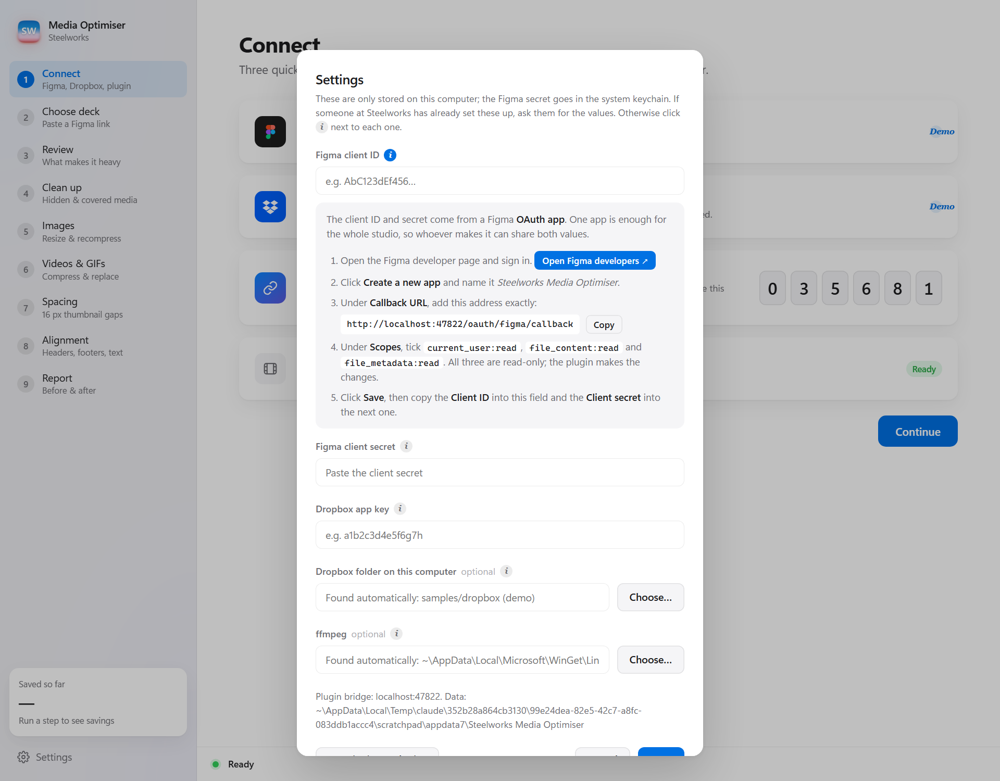 | 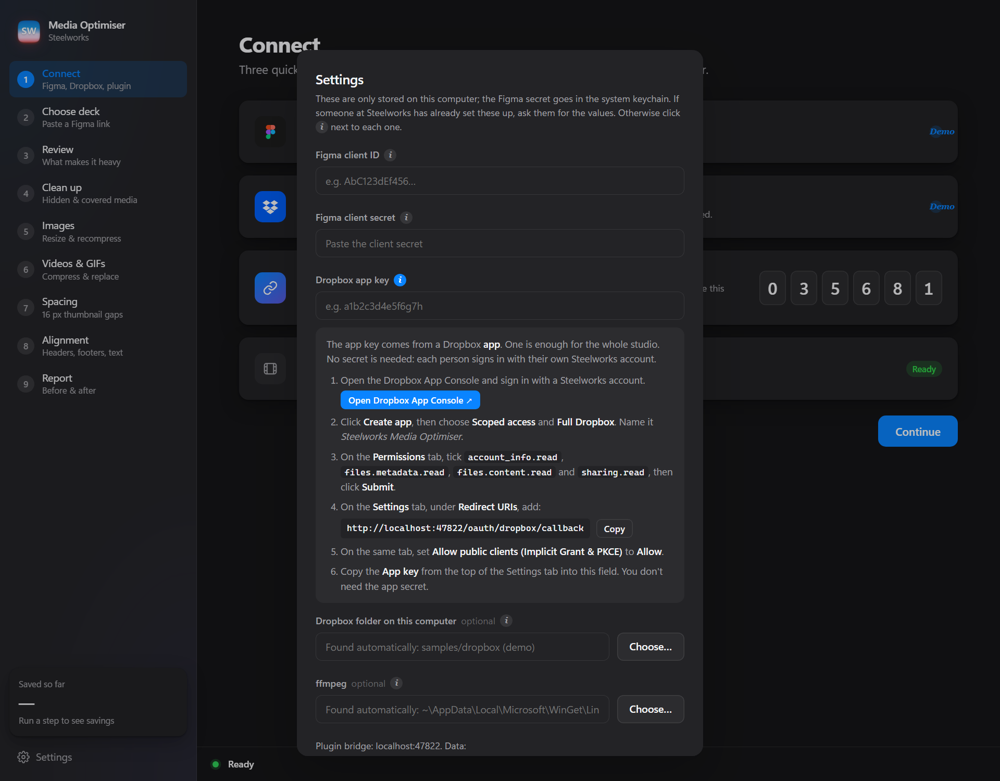 |

The two optional fields (your Dropbox folder and ffmpeg) are usually found automatically and show *Found automatically* in grey. The ⓘ explains what to do if they aren't:

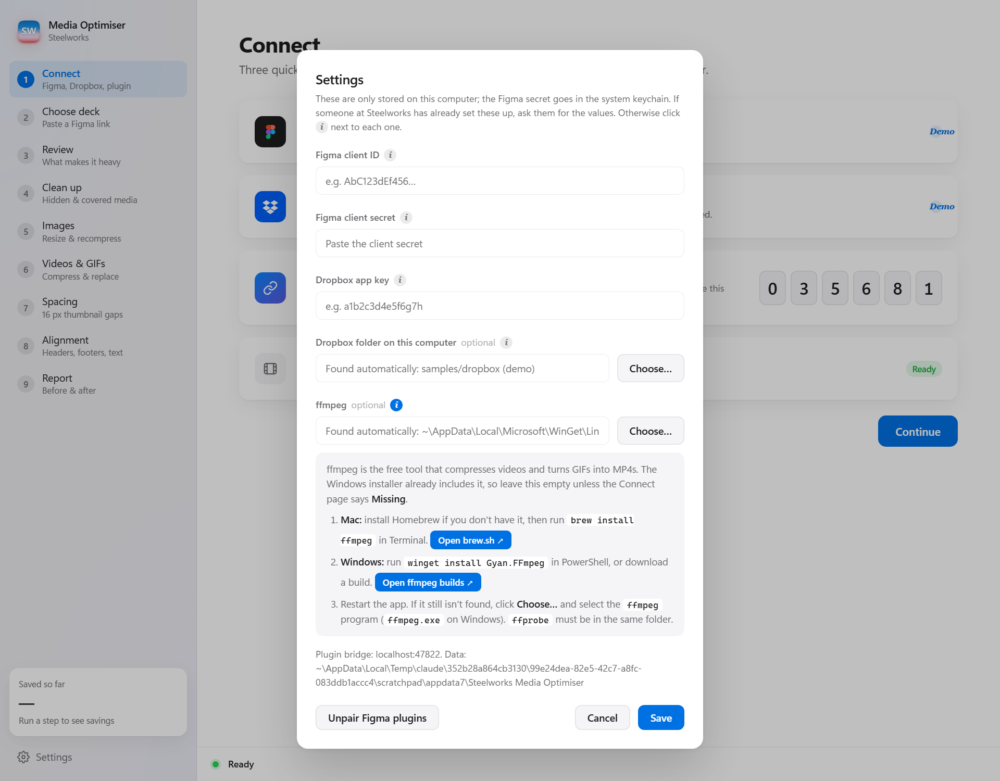

## 1 · Connect

Open **Steelworks Media Optimiser**.

* **Figma account:** *Sign in with Figma* opens your browser. Allow access and come back.
* **Dropbox:** *Sign in with Dropbox* and use your Steelworks account. It can then find original videos even if they're not synced to your computer.
* **Figma plugin:** in Figma, open the deck and run **Plugins › Development › Steelworks Media Optimiser**. Type the six-digit code shown here. You only do this once.

| The plugin asks for the code | …and then stays connected |
|---|---|
|  | 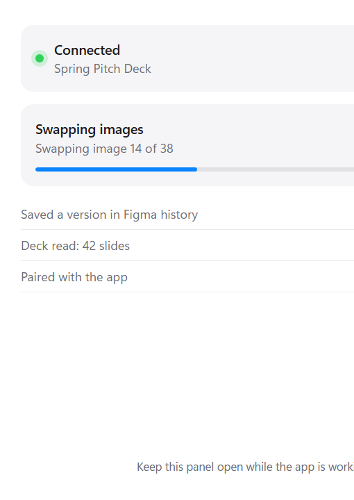 |

Keep the plugin panel open while you work. It's the app's hands inside Figma.

## 2 · Choose deck

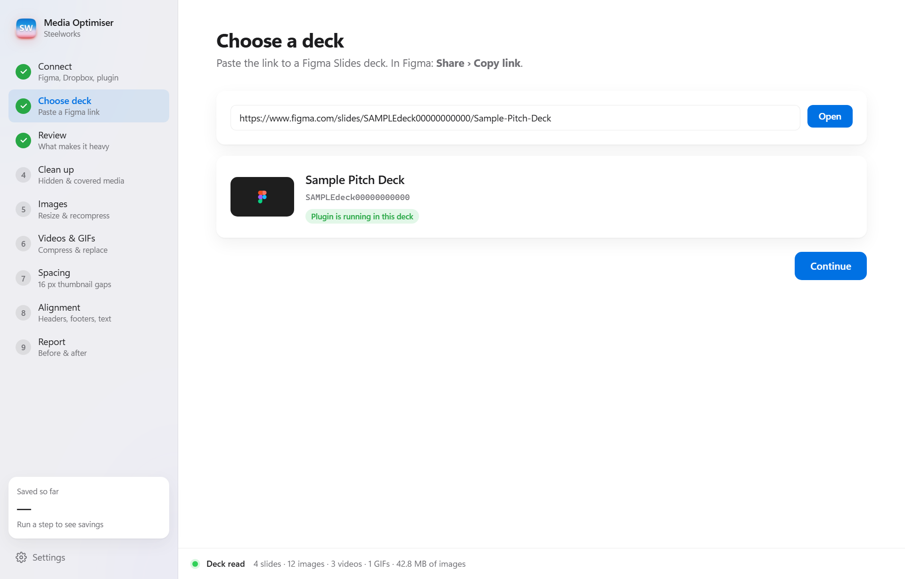

Paste the deck's link (**Share › Copy link** in Figma) and press **Open**. A green tag confirms that the plugin is running in that deck.

## 3 · Review

Press **Read deck**. You'll see the deck's total media weight and every image, GIF and video, heaviest first, with:

* **File size:** what everyone downloads when they open the deck
* **Pixels:** the image's real size
* **Shown at:** how big it appears on the slide (a *crop* tag means only part of it is visible)

Click any row to jump to that layer in Figma. Nothing changes in this step.

## 4 · Clean up

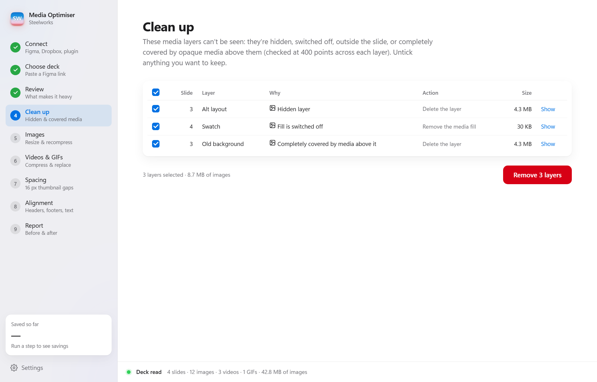

These layers are invisible but still downloaded: hidden layers, switched-off fills, layers outside the slide, and media completely covered by something opaque on top (checked at 400+ points across each layer). Click **Show** if you're unsure, untick anything you want to keep, then press **Remove**.

## 5 · Images

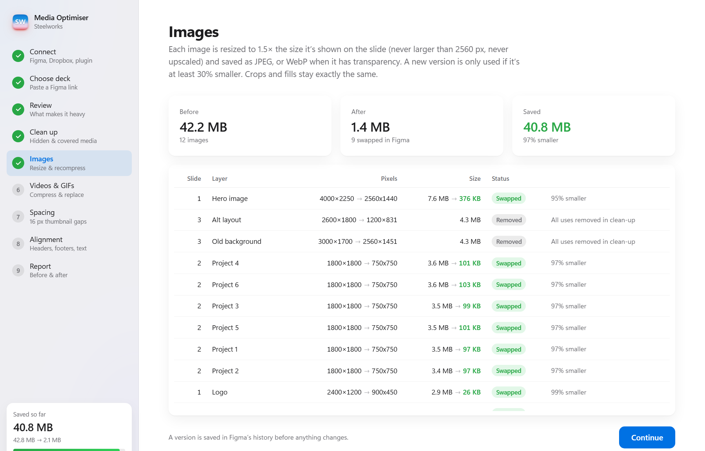

Press **Optimise images**. Each image is shrunk to 1.5× the size it's shown at, which stays sharp on big screens. Images with transparency become WebP and the rest JPEG. A new version is only used if it's at least 30% smaller. Crops, fills and positions don't change.

## 6 · Videos & GIFs

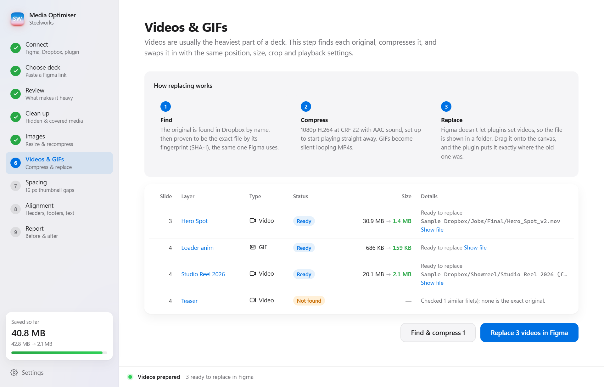

1. **Find & compress:** the app looks for each original in Dropbox by name, then checks it's *exactly* the same file (by fingerprint) before using it. It compresses each one to 1080p. GIFs become small looping videos.
2. **Replace in Figma:** for each video, a folder opens with the new file selected, and the plugin shows this card:

   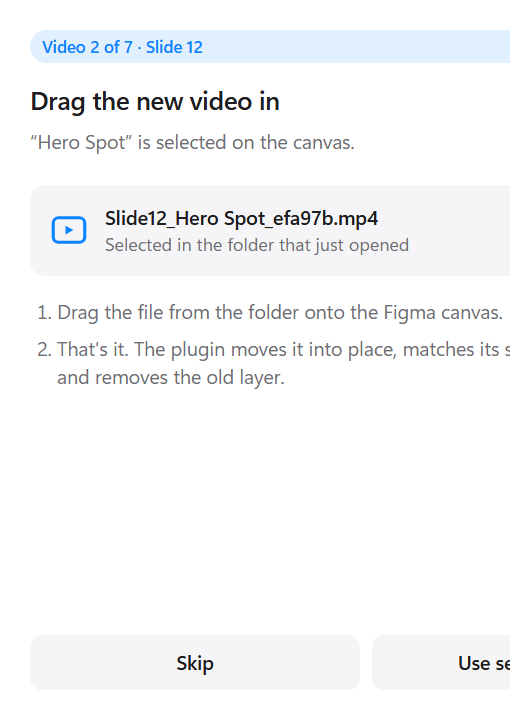

   **Drag the file onto the Figma canvas.** That's all. The plugin puts it exactly where the old one was (same position, size, crop and order) and removes the old one. Use **Skip** to do one later.

Videos marked **Not found** go on the replace list (see Report).

## 7 · Spacing

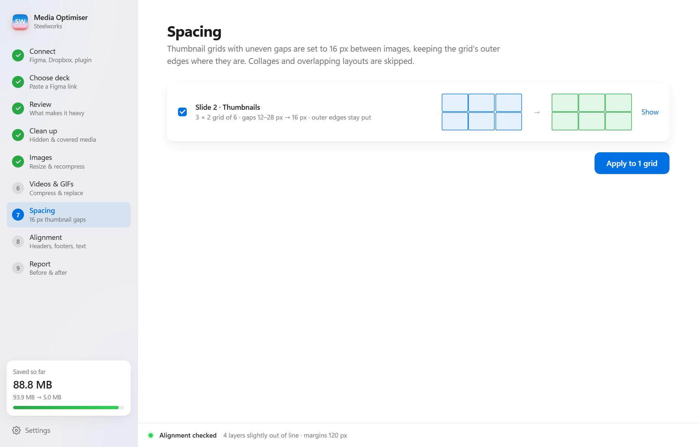

Thumbnail grids with uneven gaps are shown before and after. Applying sets every gap to 16 px and keeps the grid's outer edges where they are. Collages and overlapping layouts are never touched.

## 8 · Alignment

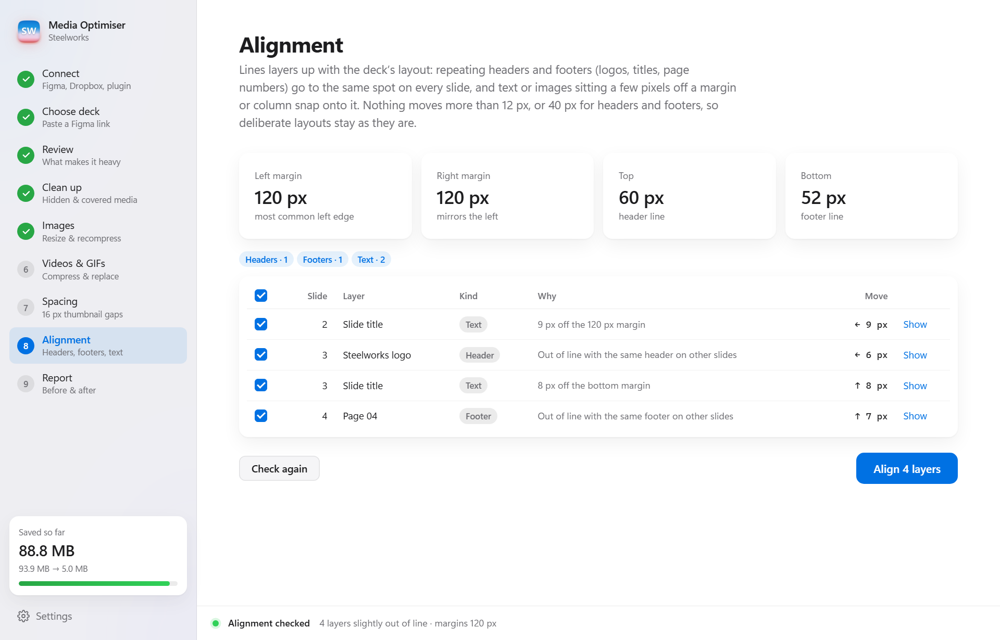

Press **Check alignment**. The tool works out the deck's margins from its layout grid, or from where content usually sits. It then finds:

* **Headers and footers** (logo, deck title, page numbers) that aren't in the same place as on the other slides
* **Text and layers** sitting a few pixels off a margin or column

It never moves anything more than 12 px (40 px for headers and footers), so layouts that are different on purpose stay as they are. Untick anything you want to leave, then press **Align**.

## 9 · Report

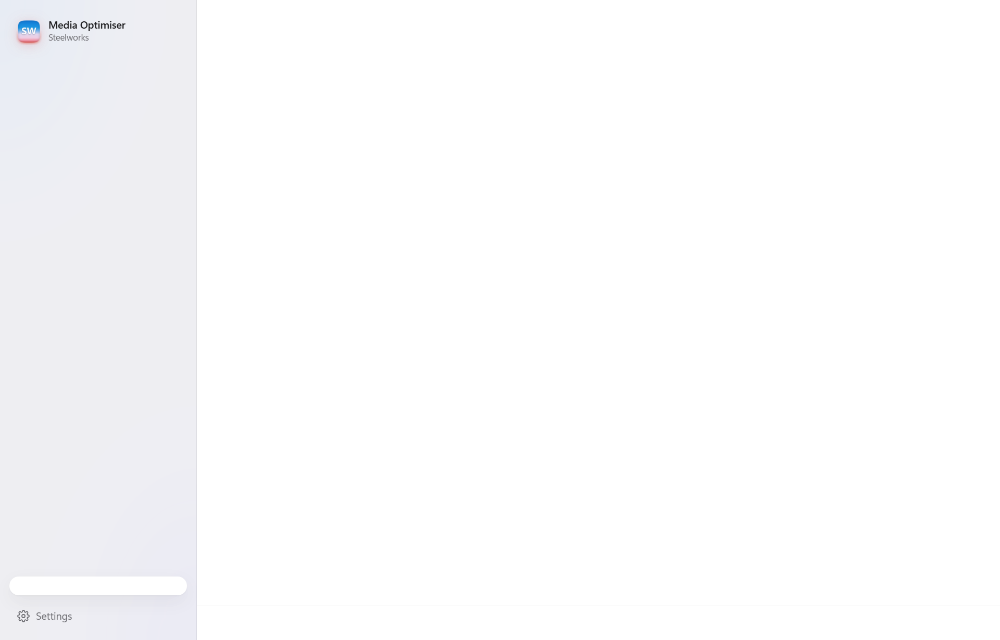

* **Export report** saves a folder in *Documents › Steelworks Media Optimiser* with:
  * **Media report.html:** before and after, step by step. Share it with the team.
  * **Replace list.csv:** anything that needs a person, such as videos whose original couldn't be found, or *check playback* items.
  * **Undo log.json:** a record of every change.
* **Undo changes** puts back image swaps, spacing and alignment. Removed layers and replaced videos come back through Figma's **File › Show version history**: pick *Before Media Optimiser…*.

The app follows your system's light or dark mode:

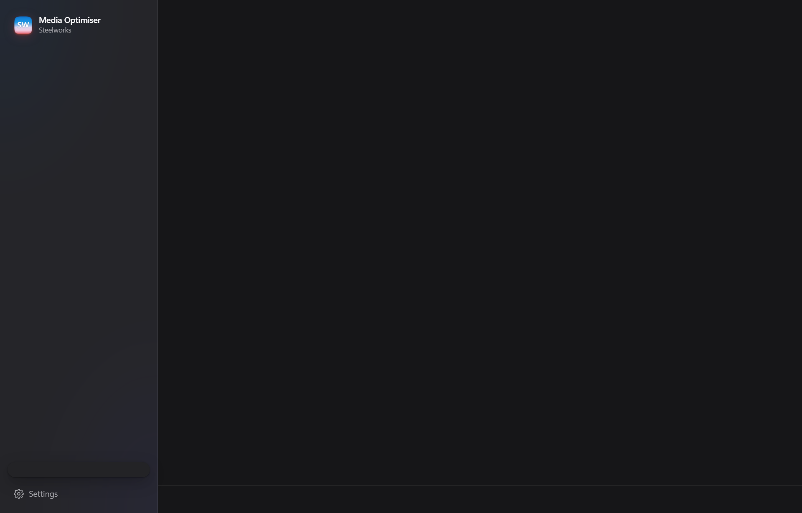

---

### Tips

* Big decks: let the Review step finish before you change slides in Figma.
* If the plugin panel says *Looking for the app…*, open the app. If that doesn't help, choose *Use a new pairing code*.
* You can close the app at any point. Run **Read deck** again to pick up where you left off.
