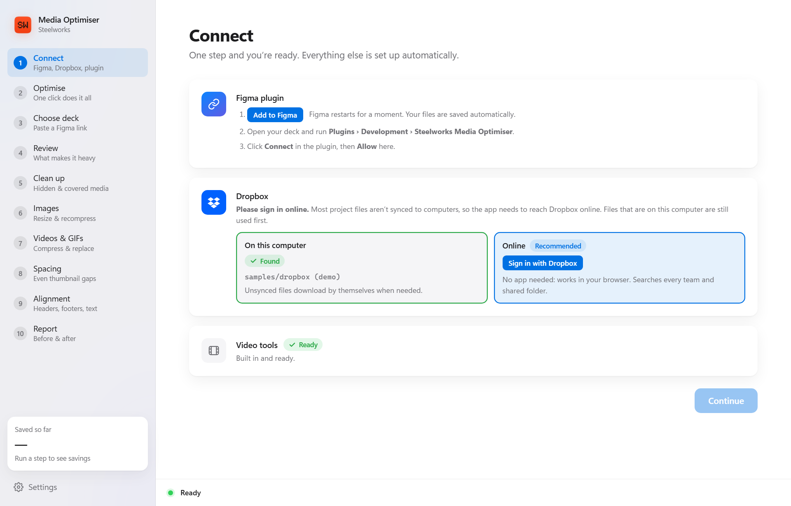
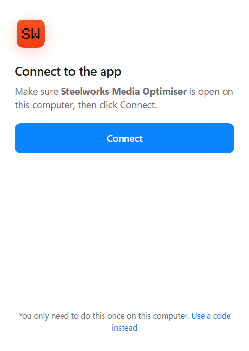
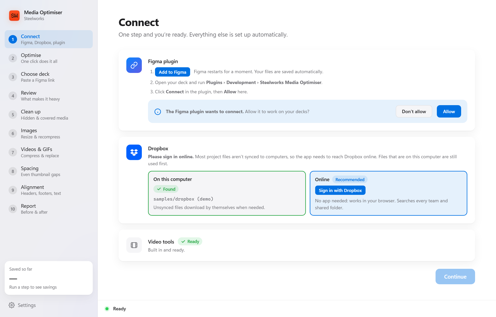
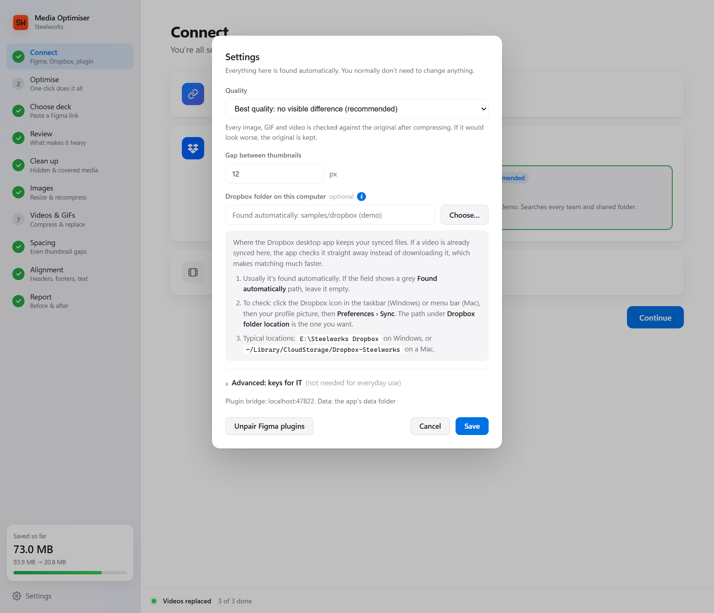
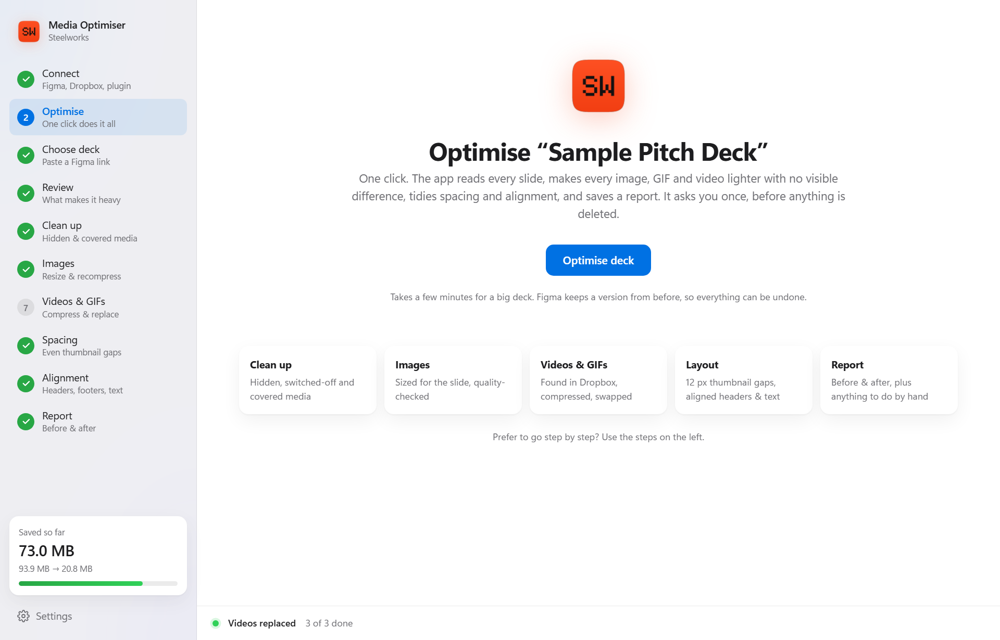
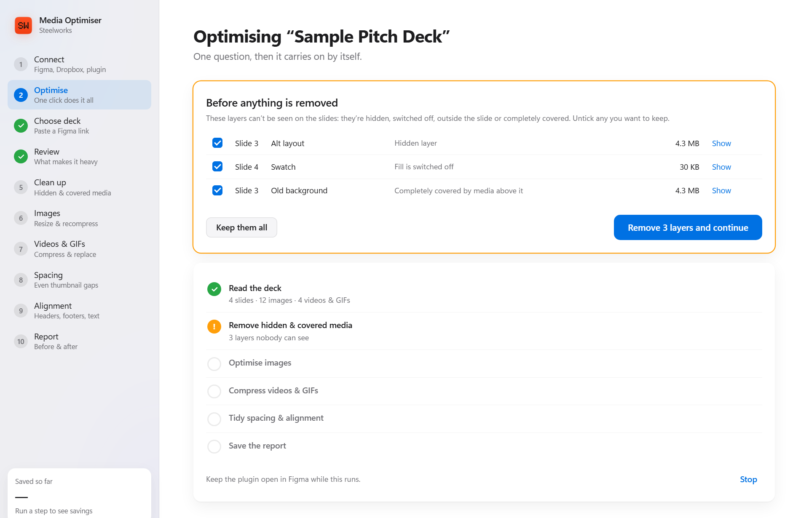
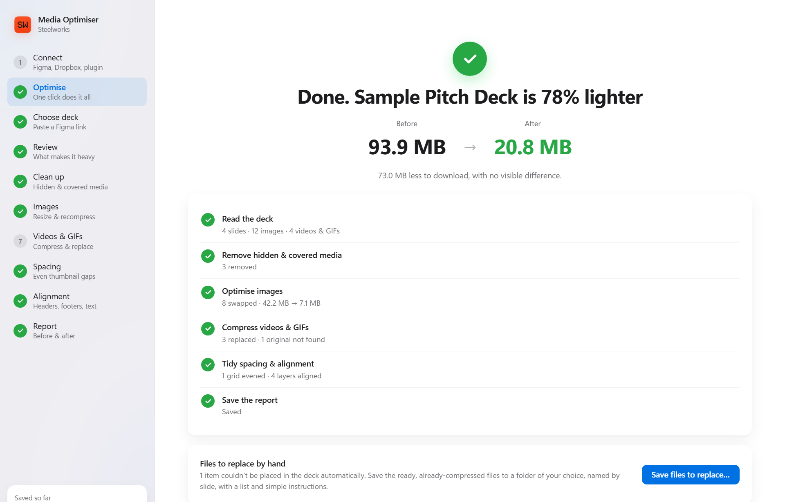
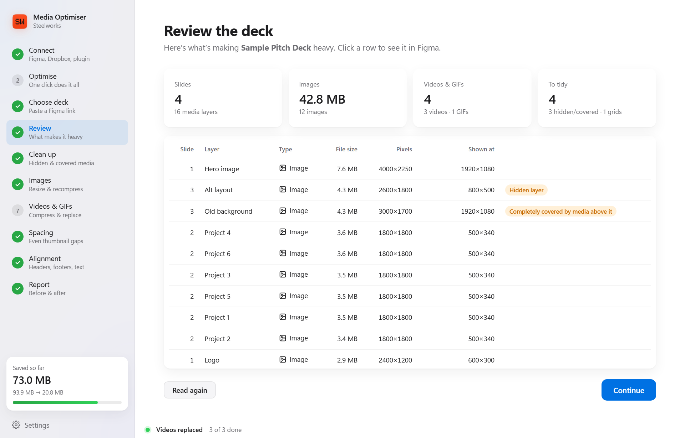

# Steelworks Media Optimiser: user guide

Use this when a Figma Slides deck is slow to open or present. One deck takes about 10–20 minutes, mostly waiting for videos to compress.

> **Before you start:** work on the real deck, not a copy. The tool saves a version in Figma's history before it changes anything, so nothing is lost.

---

## Install (2 minutes, once)

1. Download the app from the **[latest release](../../../releases/latest)**: the **Windows** `.exe` or the **Mac** `.dmg`, then open it and click through. On a Mac, drag the app into **Applications**. The first time, right-click it and choose **Open**. Video tools are built in.
2. That's it for installing. If Figma was closed, the plugin has already been added to Figma for you.

## 1 · Connect: the only setup step

The video tools are built in. Two things to do, once:

1. **Figma plugin:** click **Add to Figma** if it's there (Figma restarts for a moment; your files are saved automatically). Then open your deck and run **Plugins › Development › Steelworks Media Optimiser**, click **Connect** in the plugin, and **Allow** in the app.
2. **Dropbox:** click **Sign in with Dropbox** and allow access in your browser. Most project files only live online, so this is how the app finds them. If you also have the Dropbox app, files already on your computer are used first because it's faster.

| In the plugin: click Connect | In the app: click Allow |
|---|---|
|  |  |

That's it. The plugin stays connected on this computer from now on. Keep its panel open while you work: it's the app's hands inside Figma.

> **Settings** (bottom of the sidebar) is for unusual cases only, for example a Dropbox folder that wasn't found. Every field has an **ⓘ** that explains it.
>
> 

## 2 · Optimise: one click does it all

Open the deck in Figma with the plugin running, then click **Optimise deck**. The app works through every step by itself: it reads the deck, makes every image, GIF and video lighter with no visible difference, evens out thumbnail gaps, lines up headers, footers and text, and saves a report.

**It asks you exactly once, before anything is deleted.** Untick anything you want to keep, then click **Remove … and continue** (or **Keep them all**):

When it's finished, you see what changed:

* **Videos ready to drag in:** Figma doesn't let apps place videos by themselves. Click **Replace in Figma**, and for each video drag the file that appears onto the canvas. The plugin puts it exactly where the old one was.
* **Files to replace by hand:** click **Save files to replace…** to get anything that's left, already compressed and named by slide, in a folder you choose.

That's the whole job for most decks. The steps below are the same work, one page at a time, for when you want more control.

## Step by step (optional)

### Choose deck

Paste the deck's link (**Share › Copy link** in Figma) and press **Open**. A green tag confirms that the plugin is running in that deck.

### Review

Press **Read deck**. You'll see the deck's total media weight and every image, GIF and video, heaviest first, with:

* **File size:** what everyone downloads when they open the deck
* **Pixels:** the image's real size
* **Shown at:** how big it appears on the slide (a *crop* tag means only part of it is visible)

Click any row to jump to that layer in Figma. Nothing changes in this step.

### Clean up

These layers are invisible but still downloaded: hidden layers, switched-off fills, layers outside the slide, and media completely covered by something opaque on top (checked at 400+ points across each layer). Click **Show** if you're unsure, untick anything you want to keep, then press **Remove**.

### Images

Press **Optimise images**. Each image is resized to twice the size it's shown at, so it stays sharp on big, high-resolution screens. Photos become high-quality JPEG, transparent images WebP, and logos or graphics stay lossless. **Every result is compared with the original**: it's only used if it looks the same and is at least 30% smaller. Crops, fills and positions don't change. Photos with a camera rotation tag get an upright copy ready to place by hand (see *Files to replace* below).

### Videos & GIFs

1. **Find & compress:** the app looks for each original in Dropbox by name, then checks it's *exactly* the same file (by fingerprint) before using it. It compresses each one to 1080p. GIFs become small looping videos.
2. **Replace in Figma:** for each video, a folder opens with the new file selected, and the plugin shows this card:

   

   **Drag the file onto the Figma canvas.** That's all. The plugin puts it exactly where the old one was (same position, size, crop and order) and removes the old one. Use **Skip** to do one later.

Videos marked **Not found** go on the replace list (see Report).

### Spacing

Thumbnail grids with uneven gaps are shown before and after. Applying sets every gap to 12 px (change it in **Settings › Gap between thumbnails**) and keeps the grid's outer edges where they are. Collages and overlapping layouts are never touched.

### Alignment

Press **Check alignment**. The tool works out the deck's margins from its layout grid, or from where content usually sits. It then finds:

* **Headers and footers** (logo, deck title, page numbers) that aren't in the same place as on the other slides
* **Text and layers** sitting a few pixels off a margin or column

It never moves anything more than 12 px (40 px for headers and footers), so layouts that are different on purpose stay as they are. Untick anything you want to leave, then press **Align**.

### Report

* **Export report** saves a folder in *Documents › Steelworks Media Optimiser* with:
  * **Media report.html:** before and after, step by step. Share it with the team.
  * **Replace list.csv:** anything that needs a person, such as videos whose original couldn't be found, or *check playback* items.
  * **Undo log.json:** a record of every change.
* **Undo changes** puts back image swaps, spacing and alignment. Removed layers and replaced videos come back through Figma's **File › Show version history**: pick *Before Media Optimiser…*.

#### Files to replace

Anything the app couldn't put into the deck by itself (a video you skipped, a photo with a rotation tag) is listed under **Files to replace by hand**. Click **Save files to replace…** and choose a folder. You get every file **already compressed with no visible quality loss**, named by slide (*Slide 03 – Hero Spot.mp4*), plus a list and simple instructions. Drag each one onto its slide in place of the old layer.

The app follows your system's light or dark mode:

---

## Tips

* Big decks: let the Review step finish before you change slides in Figma.
* If the plugin panel says *Looking for the app…*, open the app. If that doesn't help, choose *Use a new pairing code*.
* You can close the app at any point. Run **Read deck** again to pick up where you left off.
